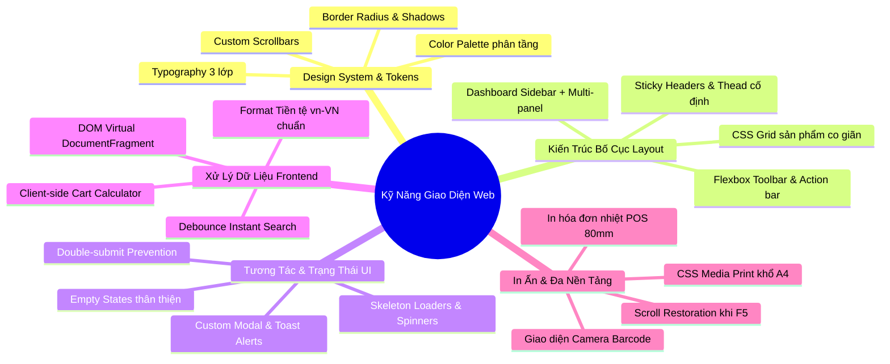

# 🎨 CẨM NANG THIẾT KẾ & LẬP TRÌNH GIAO DIỆN WEB (UI/UX)
### *(Đúc kết toàn bộ kỹ năng & bài học thực chiến từ dự án L'Amour Bookstore)*

Tài liệu này tập trung **100% vào chuyên môn LÀM GIAO DIỆN (Frontend - UI/UX)**: Từ cách xây dựng hệ thống Design System, tư duy phân cấp màu sắc, bố cục Dashboard phức tạp, tương tác người dùng (Micro-interactions), cho đến kỹ thuật in ấn hóa đơn và các cạm bẫy giao diện thường gặp.

---

## 🧭 PHẦN 1: TỔNG HỢP CÁC KỸ NĂNG LÀM GIAO DIỆN (UI/UX SKILLS)



---

### 1. Kỹ Năng Xây Dựng Hệ Thống Thiết Kế (Design System & Design Tokens)
* **Quy hoạch biến CSS `:root` tập trung:** Không bao giờ gõ mã màu hex rải rác trong code. Dự án quy hoạch toàn bộ màu sắc, kích thước, bán kính bo góc và bóng đổ thành các Design Tokens:
  * **Màu nhận diện chủ đạo (Theme Palette):** Xanh Navy cổ điển (`--navy-950: #061122`, `--navy-900: #0A1930`) tượng trưng cho sự trang nhã, tri thức.
  * **Màu điểm nhấn sang trọng:** Vàng ánh kim (`--gold: #C7A15A`, `--gold-hover: #D8B26B`) dùng cho nút hành động chính, huy hiệu sách bán chạy.
  * **Màu nền giấy tự nhiên:** Nền kem (`--cream: #FAF7F0`, `--cream-dark: #F3EFE6`) tạo cảm giác như những trang sách thật, giảm mỏi mắt cho nhân viên thu ngân.
  * **Màu ngữ thái (Semantic Colors):** Xanh lục thành công (`--emerald`), Đỏ cảnh báo (`--danger`), Cam chờ xử lý (`--warning`).
* **Nghệ thuật phối hợp Typography (3 lớp phông chữ):**
  * `Fraunces` (Editorial Serif): Dành cho tiêu đề lớn, tên sách, tạo phong thái văn học, nghệ thuật.
  * `Inter` (Modern Sans-serif): Dành cho toàn bộ văn bản UI, nhãn nút, bảng biểu để đọc nhanh và rõ nét trên mọi màn hình.
  * `IBM Plex Mono` (Monospace): Dành riêng cho mã hóa đơn (`HD-2026-001`), mã ISBN sách, giá tiền (`120.000 đ`) để các con số luôn thẳng hàng thẳng cột.

---

### 2. Kỹ Năng Xây Dựng Bố Cục Dashboard Phức Tạp (Layout Architecture)
* **Bố cục khung điều hành chống tràn (Full-height No-scroll Layout):**
  * Thân trang: `body { height: 100vh; overflow: hidden; }` giúp cố định màn hình làm việc, không bị thanh cuộn trình duyệt làm giật trang.
  * **Sidebar cố định bên trái (`--sidebar-w: 250px`):** Luôn ghim cố định các menu chức năng.
  * **Main Content tự giãn (`flex: 1; overflow-y: auto`):** Cuộn độc lập mượt mà.
  * **Giỏ hàng POS cố định bên phải (`--cart-w: 470px`):** Giúp thu ngân vừa chọn sách bên trái vừa kiểm soát đơn bên phải mà không phải nhảy trang.
* **CSS Grid Responsive linh hoạt:**
  * Lưới danh mục & sách tự co giãn: `grid-template-columns: repeat(auto-fill, minmax(220px, 1fr)); gap: 20px;` - hiển thị đẹp từ màn hình laptop nhỏ đến màn hình 2K.
* **Sticky Table Headers:**
  * Khóa cố định hàng tiêu đề bảng (`thead { position: sticky; top: 0; z-index: 10; }`) để khi xem bảng 500 dòng hóa đơn, người dùng luôn biết cột nào là giá, cột nào là số lượng.

---

### 3. Kỹ Năng Tương Tác Người Dùng & Trạng Thái (Micro-interactions & States)
* **Hệ thống Toast Notification không làm phiền:** Thông báo dạng thẻ trôi nhẹ nhàng từ góc phải màn hình (`showToast('Thêm vào giỏ thành công', 'success')`) tự động biến mất sau 3 giây.
* **Hộp thoại xác nhận tùy biến (Custom Modal Confirm):** Thay thế hoàn toàn hàm `confirm()` xấu xí của trình duyệt bằng modal hộp thoại có animation mượt mà, phân loại rõ nút "Hủy" và "Xác nhận hành động nguy hiểm".
* **Xử lý trạng thái rỗng (Empty State):** Khi giỏ hàng trống hoặc tìm kiếm không thấy sách, luôn có icon minh họa + dòng thông điệp hướng dẫn người dùng hành động tiếp theo, không để trang trắng trơn.
* **Hiệu ứng nút tương tác (Button States):** Đủ 4 trạng thái: *Default*, *Hover* (sáng hơn nhẹ), *Active* (lún xuống nhẹ `transform: translateY(1px)`), và *Disabled* (mờ đi + con trỏ `not-allowed`).

---

### 4. Kỹ Năng Xử Lý Dữ Liệu Giao Diện Bằng JavaScript Thuần (Vanilla JS)
* **Kỹ thuật Debounce cho ô tìm kiếm tức thì (Instant Search):** Trì hoãn 300ms sau khi người dùng dừng gõ phím mới tiến hành lọc sách, giúp giao diện không bị giật lag khi gõ nhanh.
* **Format tiền tệ chuẩn bản địa:** Luôn dùng `price.toLocaleString('vi-VN') + ' đ'` để hiển thị giá tiền rõ ràng (`1.500.000 đ` thay vì `1500000`).
* **Tính toán giỏ hàng Client-side Realtime:** Khi bấm tăng/giảm số lượng hoặc chọn mã giảm giá, tiền hàng, thuế VAT và tổng thanh toán nhảy số tức thì mà không cần load lại trang.

---

### 5. Kỹ Năng Thiết Kế In Ấn Chuyên Nghiệp (Print Media CSS)
* **In hóa đơn bán lẻ tại quầy (Khổ giấy in nhiệt 80mm/58mm):** Căn lề hẹp, font chữ nét thanh, tối ưu hiển thị mã vạch để máy in bill cắt giấy chuẩn xác.
* **In biên bản bàn giao ca & báo cáo doanh thu khổ A4:**
  * Ẩn toàn bộ menu, thanh điều hướng và nút bấm: `.no-print { display: none !important; }`.
  * Xóa bỏ màu nền tối và đổ bóng: `body { background: #FFF !important; box-shadow: none !important; }`.
  * Khóa ngắt trang thông minh: `tr { page-break-inside: avoid; }` để không bị xé đôi một dòng dữ liệu giữa 2 trang giấy.

---

## ⚠️ PHẦN 2: CÁC LƯU Ý SỐNG CÒN KHI LÀM GIAO DIỆN WEB

Dưới đây là 10 lỗi kinh điển về giao diện được khắc phục trực tiếp trong dự án:

---

### 1. Không bao giờ cấm chọn chữ (`user-select: none`) trên toàn bộ trang
* **Sai lầm:** Nhiều bạn lập trình viên đặt `* { user-select: none; }` để web "giống app". Hậu quả: Khách hàng và kế toán không thể bôi đen copy mã đơn hàng, số tài khoản, số điện thoại hay tên sách.
* **Kinh nghiệm chuẩn:**
  * Cho phép chọn chữ trên toàn bộ bảng dữ liệu, đoạn văn, thẻ thông tin:
    ```css
    .data-table, .inv-card, table, tr, td, th, p, span {
      user-select: text;
      -webkit-user-select: text;
    }
    ```
  * Chỉ vô hiệu hóa chọn chữ trên nút bấm, icon điều hướng:
    ```css
    button, .badge, .nav-item {
      user-select: none;
    }
    ```

---

### 2. Tuyệt đối không dùng `alert()` hoặc `confirm()` mặc định
* **Sai lầm:** Dùng `alert('Xóa thành công!')` hoặc `confirm('Bạn có chắc muốn hủy đơn?')`. Hàm này chặn đứng luồng render của trình duyệt, giao diện thô kệch, không đồng bộ với phong cách website và dễ gây lỗi đơ trang trên điện thoại.
* **Kinh nghiệm chuẩn:** Tự dựng component modal bằng HTML/CSS và quản lý qua Promise:
  ```javascript
  const confirmed = await showCustomConfirm({
    title: 'Xác nhận xóa sách',
    message: 'Hành động này không thể hoàn tác!',
    confirmText: 'Xóa ngay',
    type: 'danger'
  });
  if (confirmed) { /* Xử lý xóa */ }
  ```

---

### 3. Cạm bẫy bấm đúp nút (Double Submit / Spam Click)
* **Sai lầm:** Khi mạng chậm, người dùng nhấn nút "Thanh toán" hoặc "Lưu hóa đơn" liên tiếp 2-3 lần. Kết quả: Tạo ra 3 đơn hàng trùng nhau trong database.
* **Kinh nghiệm chuẩn:** Ngay khi click, lập tức khóa nút và hiển thị trạng thái đang tải:
  ```javascript
  btn.disabled = true;
  const originalText = btn.innerHTML;
  btn.innerHTML = '<span class="spinner"></span> Đang tạo hóa đơn...';
  try {
    await submitOrder();
  } finally {
    btn.disabled = false;
    btn.innerHTML = originalText;
  }
  ```

---

### 4. Tùy biến thanh cuộn (Custom Scrollbar) cho trang nhã
* **Sai lầm:** Để thanh cuộn mặc định của Windows màu xám to đùng, che mất nội dung và làm hỏng thẩm mỹ cao cấp của website.
* **Kinh nghiệm chuẩn:** Dùng CSS thanh mảnh, cùng tông màu với giao diện:
  ```css
  ::-webkit-scrollbar { width: 6px; height: 6px; }
  ::-webkit-scrollbar-track { background: transparent; }
  ::-webkit-scrollbar-thumb {
    background: rgba(10, 25, 48, 0.15);
    border-radius: 99px;
  }
  ::-webkit-scrollbar-thumb:hover { background: var(--gold); }
  ```

---

### 5. Quản lý phân tầng `z-index` có hệ thống
* **Sai lầm:** Đặt số `z-index` bừa bãi kiểu `z-index: 999999`. Hậu quả: Menu bị che bởi modal, hoặc tooltip đè lên cả popup thanh toán.
* **Kinh nghiệm chuẩn:** Quy ước thang bậc `z-index` rõ ràng:
  * Lớp nền/Thẻ bình thường: `z-index: 1 - 10`
  * Tiêu đề bảng / Thanh công cụ dính: `z-index: 100`
  * Header / Thanh điều hướng chính: `z-index: 500`
  * Nền mờ Modal (Backdrop): `z-index: 1000`
  * Hộp thoại Modal chính: `z-index: 1050`
  * Thông báo Toast nổi: `z-index: 2000`

---

### 6. Xử lý cắt chữ khi nội dung quá dài (Text Truncation)
* **Sai lầm:** Tên cuốn sách quá dài làm vỡ hàng trong bảng dữ liệu hoặc đẩy nút bấm tụt xuống dưới.
* **Kinh nghiệm chuẩn:**
  * Cắt 1 dòng:
    ```css
    .truncate-1 {
      white-space: nowrap;
      overflow: hidden;
      text-overflow: ellipsis;
    }
    ```
  * Cắt tối đa 2 dòng (cho mô tả sách):
    ```css
    .truncate-2 {
      display: -webkit-box;
      -webkit-line-clamp: 2;
      -webkit-box-orient: vertical;
      overflow: hidden;
    }
    ```

---

### 7. Khôi phục đỉnh trang khi tải lại (Scroll Restoration)
* **Sai lầm:** Khi người dùng cuộn xuống chân trang rồi ấn F5, trình duyệt cố nhớ vị trí cũ khiến trang web nhảy giật cục hoặc hiển thị dở dang.
* **Kinh nghiệm chuẩn:** Đặt đoạn script ngắn ngay đầu thẻ `<head>`:
  ```html
  <script>
    if ('scrollRestoration' in history) {
      history.scrollRestoration = 'manual';
      window.scrollTo(0, 0);
    }
  </script>
  ```

---

### 8. Thiết kế phân cấp thị giác (Visual Hierarchy)
* **Sai lầm:** Nút nào cũng to, chữ nào cũng đậm, màu nào cũng rực rỡ khiến người dùng bị hoa mắt, không biết đâu là hành động chính.
* **Kinh nghiệm chuẩn:** 
  * **Primary Action (1 nút duy nhất trên màn hình):** Nút màu Vàng Gold hoặc Xanh đậm nổi bật nhất (ví dụ: *Thanh toán*, *Tạo hóa đơn*).
  * **Secondary Action:** Nút viền trong suốt (`outline`), màu chữ dịu (ví dụ: *In tạm tính*, *Xuất Excel*).
  * **Destructive Action:** Nút chữ đỏ, nền nhạt (`--danger-100`) (ví dụ: *Hủy đơn*, *Xóa sản phẩm*).

---

### 9. Luôn có nhãn định danh (`label` & `placeholder` thông minh)
* **Sai lầm:** Chỉ dùng `placeholder` mà không có `label`, khi người dùng bắt đầu gõ thì biến mất gợi ý, không nhớ ô đó đang nhập cái gì.
* **Kinh nghiệm chuẩn:** Kết hợp tiêu đề nhỏ phía trên ô nhập (Floating Label hoặc Sub-label) và placeholder hiển thị định dạng mẫu (ví dụ: `Ví dụ: 0902 999 001`).

---

### 10. Chăm chút trải nghiệm in ấn bằng CSS `@media print`
* **Sai lầm:** Không tối ưu in ấn, khi thu ngân bấm Ctrl+P để in hóa đơn, trang in hiển thị cả thanh sidebar màu đen, menu điều hướng và tiêu tốn hàng đống mực in.
* **Kinh nghiệm chuẩn:** Luôn có khối `@media print` để ẩn sạch thành phần điều hướng, chỉ giữ lại đúng vùng giấy in hóa đơn với nền trắng và chữ đen rõ nét.

---

## 📋 CHECKLIST GIAO DIỆN (UI/UX) TRƯỚC KHI BÀN GIAO SẢN PHẨM

- [ ] Phông chữ hiển thị mượt, các con số mã đơn/giá tiền có thẳng hàng không (`monospace`)?
- [ ] Bảng dữ liệu có cho phép người dùng bôi đen copy mã số không?
- [ ] Khi click nút lưu/gửi dữ liệu, nút có bị vô hiệu hóa để chống spam click không?
- [ ] Đã thay thế toàn bộ `alert()` và `confirm()` bằng Modal/Toast chưa?
- [ ] Bảng dài có khóa cố định thanh tiêu đề `thead` khi cuộn không?
- [ ] Giao diện có hiển thị thông báo thân thiện khi không có dữ liệu (Empty State) không?
- [ ] Thử nhấn `Ctrl + P` xem bản in có bị vỡ hoặc dính menu điều hướng không?
- [ ] Thử co nhỏ màn hình trình duyệt xem các khối có tự động co giãn đẹp mắt không?
